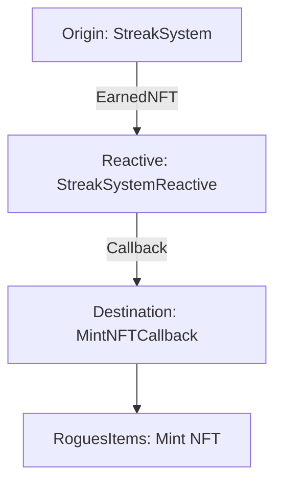

# Day 1 — Reactive Use Case

## Project
Rogues Studio — World of Rogues

## 1. Origin Chain and Event
- Origin Chain: Not specified
- Origin Contract: StreakSystem
- Event: EarnedNFT

## 2. Trigger Condition
Players reach a configured login streak milestone and earns an NFT reward.

## 3. Destination and Action

- Destination Chain: Not specified.
- Callback Contract: MintNFTCallback
- Action: Mint an NFT through RoguesItems.

## 4. Without Reactive

Without Reactive, the game would need a bot to monitor events and trigger NFT minting.

Benefit: Less need for a custom monitoring bot.

Cost: Gas fees, funding, and callback failure risks.

## Architecture

## Sources

https://blog.reactive.network/reactive-streak-system-in-world-of-rogues/
